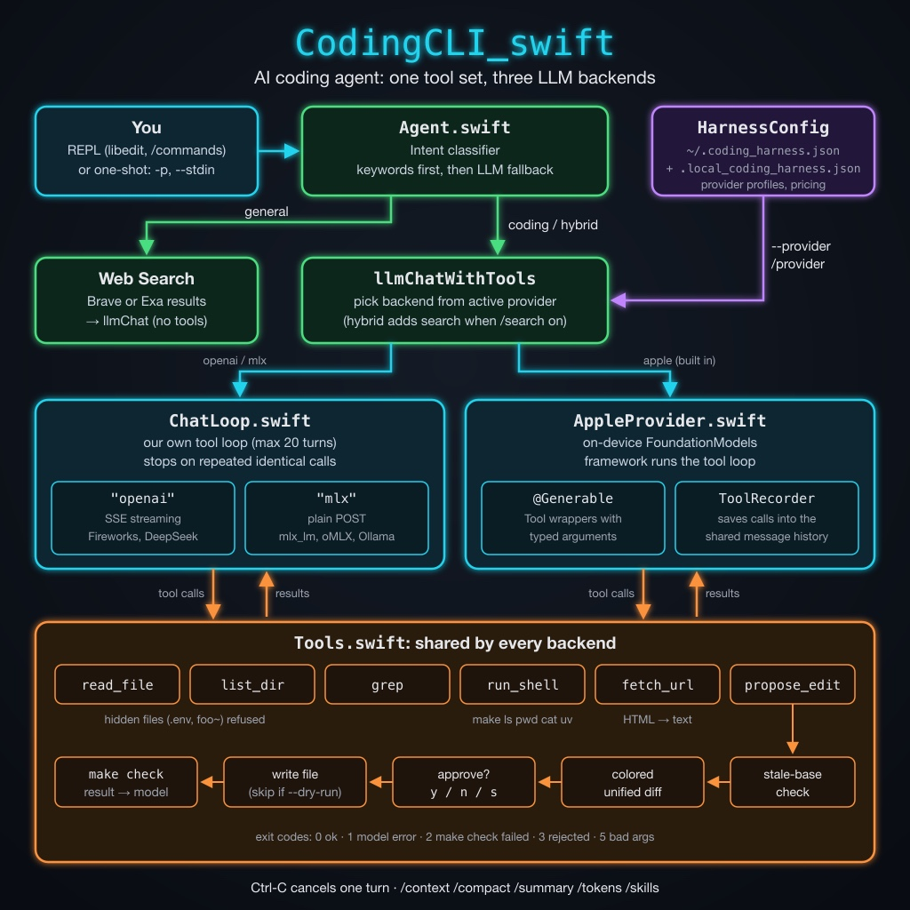

# AI Harness/Coding Agent

In this chapter we build **CodingCLI**, an AI pair programmer that runs in your terminal. You type a request such as "fix the bug in calc.py" and the agent reads your files, searches the code, runs a few safe shell commands, and proposes edits. Every edit appears as a colored diff that you approve or reject before the agent touches a file. After each accepted edit the agent runs `make check` and reports any failure back to the model.

The agent can talk to three kinds of LLM backend:

- **Apple Intelligence**, the on-device model in the `FoundationModels` framework. It needs no API key and makes no network calls. This provider is built in, so CodingCLI works with no config file at all.
- Any **OpenAI-compatible** cloud endpoint, such as Fireworks.ai or DeepSeek, using streaming chat completions.
- A **local MLX or Ollama** server that speaks the OpenAI `/v1/chat/completions` protocol.

This program ports the feature set of my Python and Racket coding agents to Swift. It is larger than most examples in this book (about 2,600 lines in 13 files), so this chapter shows the key parts of the code and explains how they fit together. The full source is in the directory `source-code/CodingCLI_swift`.

## Requirements

- **macOS 26 (Tahoe) or later.** `FoundationModels` ships as a system framework starting with macOS 26.
- **Xcode 17 or later** to build against `FoundationModels`.
- **Apple Intelligence enabled** in System Settings, but only for the built-in `apple` provider.

There are no third-party Swift packages. Cloud providers need an API key in an environment variable (`FIREWORKS_API_KEY`, `DEEPSEEK_API_KEY`, or whatever the provider profile names). Web search needs `BRAVE_SEARCH_API_KEY` or `EXA_SEARCH_API_KEY`.

## Features

- An **agentic loop** with six tools: `read_file`, `list_dir`, `grep`, `run_shell`, `propose_edit`, and `fetch_url`.
- **Colored unified diffs** with a `y/n/s` (yes, no, skip and tell the model why) prompt before any file changes. `--dry-run` never writes and `-y` approves without asking but still shows the diff.
- A **`make check` gate** after every accepted edit.
- **Safety guards:** a whitelist for shell commands, refusal to read hidden files such as `.env`, stale-base checks on edits, and a stop when the model repeats the same tool call.
- An **intent classifier** that sends general questions to web search and coding tasks to the tools.
- **Skills:** `/<name>` loads `~/.agents/skills/<name>/SKILL.md` into the conversation.
- **Context tools:** `/context`, `/compact`, and `/summary`.
- **Token counts and cost estimates** with `/tokens`.
- A **one-shot mode** with exit codes for scripts.
- **Line editing** with history, `Ctrl-R`, and Tab completion through libedit.

## Project Layout

```text
CodingCLI_swift/
├── Package.swift
├── Makefile                   # build / check / install (make check gates every accepted edit)
├── coding_harness.example.json
└── Sources/CodingCLI/
    ├── CodingCLI.swift        # @main entry point, CLI flag parsing
    ├── Agent.swift            # REPL, slash commands, skills, context, intent routing, one-shot mode
    ├── ChatLoop.swift         # provider-agnostic agentic tool-calling loop
    ├── OpenAIClient.swift     # OpenAI-compatible SSE + MLX clients, token/cost stats
    ├── AppleProvider.swift    # Apple Intelligence provider, FoundationModels tools, /summary
    ├── Tools.swift            # tool registry and the six agent tools
    ├── Approval.swift         # settings, subprocess helper, colored diffs, y/n/s prompts
    ├── HarnessConfig.swift    # hierarchical JSON config, provider profiles, legacy config
    ├── Search.swift           # Brave and Exa web search
    ├── WebFetch.swift         # fetch_url: download a page, HTML -> plain text
    ├── LineInput.swift        # libedit line editing, history, Tab completion
    └── JSON.swift             # JSON value type
```



The flow of one request is:

1. `Agent` reads a line in the REPL (or takes the one-shot prompt) and classifies its intent.
2. A coding request goes to `llmChatWithTools`, which picks a backend from the active provider profile.
3. For `openai` and `mlx` providers, `ChatLoop` runs the tool-calling loop itself. For the `apple` provider, `FoundationModels` runs its own loop and `AppleProvider` records each tool call.
4. Both paths call the same tool code in `Tools.swift`, so the diffs, approvals, and safety checks behave the same for every backend.

## Package.swift

```swift
// swift-tools-version: 6.2
// The swift-tools-version declares the minimum version of Swift required to build this package.

import PackageDescription

let package = Package(
    name: "CodingCLI",

    // macOS 26 is required for FoundationModels (the built-in "apple"
    // provider). Remote/local OpenAI-compatible providers need nothing extra.
    platforms: [
        .macOS(.v26)
    ],

    products: [
        .executable(name: "CodingCLI", targets: ["CodingCLI"])
    ],

    targets: [
        .executableTarget(
            name: "CodingCLI",

            // Link the system framework that ships with Xcode 17+
            // (no external dependency required). libedit, for line editing,
            // is loaded at run time with dlopen.
            linkerSettings: [
                .linkedFramework("FoundationModels")
            ]
        )
    ],

    // Swift 5 language mode: the CLI is effectively single-threaded and keeps
    // its session state in plain statics.
    swiftLanguageModes: [.v5]
)
```

The `.linkedFramework("FoundationModels")` setting links the system framework without a package dependency. The package uses Swift 5 language mode because the tool keeps session state in static variables and runs one request at a time; Swift 6 strict concurrency checks would add work with no benefit here.

## The Makefile and the `make check` Gate

The agent runs `make check` after every edit you accept. In this project `check` just builds the code:

```makefile
check: build

lint: check
```

In your own projects, point `check` at whatever proves the code still works: a compiler, a test suite, or a linter. If `make check` fails, the tool result tells the model, and it can try to fix the problem. The Makefile also has `build`, `release`, `run`, `install`, `uninstall`, and `clean` targets. `make install` copies the release binary to `~/bin` by default; set `PREFIX` to change that.

## The Tools

`Tools.swift` defines a small registry. Each tool has a name, a description, a list of string parameters, and a handler:

```swift
struct ToolParam {
    let name: String
    let type: String
    let description: String
}

struct ToolSpec {
    let name: String
    let description: String
    let params: [ToolParam]
    // Positional string arguments, in `params` order.
    let handler: ([String]) -> String
}
```

`Tools.render` turns registered tools into the OpenAI `"tools"` JSON array that cloud and MLX models expect. `registerAll` defines the six tools. Here are two of them:

```swift
        define("propose_edit",
               [ToolParam(name: "path", type: "string", description: "Path to the file to edit or create."),
                ToolParam(name: "old", type: "string", description: "For an existing file: the exact current contents. For a new file: pass empty string."),
                ToolParam(name: "new", type: "string", description: "The proposed new contents of the file, in full.")],
               "Propose an edit or new-file creation. The user is shown a unified diff and asked to approve. On approval the file is written and `make check` is run.",
               { proposeEdit($0[0], $0[1], $0[2]) })
        define("fetch_url",
               [ToolParam(name: "url", type: "string", description: "Web page URL (http or https).")],
               "Fetch a web page and return its readable text content (HTML tags, scripts, and styles removed; long pages truncated). Use this whenever the user asks about the contents of a web site or URL.",
               { WebFetch.fetch($0[0]) })
```

### Handling Bad Tool Calls

Small models often send malformed tool calls. `runOne` turns each kind of error into a message for the model rather than throwing an error that would end the loop:

```swift
    static func runOne(name: String, argsJSON: String) -> String {
        let short = argsJSON.count <= 120 ? argsJSON : String(argsJSON.prefix(117)) + "..."
        if !Settings.quiet { print("* \(name) \(short)") }
        if name.trimmingCharacters(in: .whitespaces).isEmpty {
            // The model stopped mid-generation, so no function name survived.
            return "Error: the model's tool call was truncated mid-generation (no function name provided). Received arguments: \(short)"
        }
        guard let parsed = try? JSON.parse(argsJSON) else {
            return "Error: invalid JSON in arguments for tool '\(name)'. Received: \(short)"
        }
        guard let obj = parsed.object else {
            return "Error: arguments for tool '\(name)' must be a JSON object. Received: \(short)"
        }
        return callTool(name, obj)
    }
```

`callTool` also checks for missing arguments and lists the expected ones, which gives a confused model a clear way to retry.

### Shell Commands

`run_shell` only runs commands on a whitelist: `make`, `ls`, `pwd`, `cat`, and `uv`. It refuses any argument that names a hidden file, and it disables `uv` under `--dry-run` since `uv run` can execute code that writes files:

```swift
    static func runShell(_ command: String) -> String {
        let tokens = command.split(whereSeparator: { $0 == " " || $0 == "\t" || $0 == "\n" }).map(String.init)
        guard let cmd = tokens.first else { return "empty command" }
        if !shellWhitelist.contains(cmd) {
            return "Command '\(cmd)' not whitelisted. Allowed: \(shellWhitelist.sorted().joined(separator: ", "))"
        }
        // `uv run` executes arbitrary code, which could write files behind a
        // --dry-run preview, so it is unavailable in that mode.
        if Settings.dryRun && cmd == "uv" {
            return "refused: 'uv' is disabled in --dry-run mode, where no files may be written. The user only wants to preview the proposed diffs."
        }
        if cmd != "ls", let bad = tokens.dropFirst().first(where: isHiddenArg) {
            return "refusing to run command referencing hidden/internal file: \(bad)"
        }
        do {
            let (out, code) = try Subprocess.run(cmd, Array(tokens.dropFirst()))
            return (cmd == "ls" ? filterLsOutput(out) : out) + "(exit \(code))"
        } catch {
            return "Error running command: \(error)"
        }
    }
```

The command runs through `Process` with an argument array, not through a shell, so pipes, redirects, and `;` have no special meaning.

### Proposing Edits

`propose_edit` takes the whole old file and the whole new file. Asking for full contents is simpler and more reliable with small models than asking for patches. The function makes several checks before it shows a diff:

```swift
    static func proposeEdit(_ path: String, _ old: String, _ proposed: String) -> String {
        let exists = FileManager.default.fileExists(atPath: path)
        var new = proposed
        var current = ""
        if exists {
            do {
                current = try String(contentsOfFile: path, encoding: .utf8)
            } catch {
                return "Error reading \(path): \(error.localizedDescription)"
            }
        }
        if exists && trimTrailingWhitespace(current) != trimTrailingWhitespace(old) {
            return "stale base: on-disk contents of \(path) do not match the 'old' you provided. Read the file again and retry."
        }
        // Keep the conventional final newline the model left off.
        if (current.hasSuffix("\n") || !exists), !new.isEmpty, !new.hasSuffix("\n") {
            new += "\n"
        }
        if exists && current == new {
            return "no changes (proposed content matches current file)"
        }
        if !exists && new.isEmpty {
            return "refused: cannot create an empty file"
        }
        let diff = Approval.unifiedDiff(old: current, new: new, oldLabel: "a/\(path)", newLabel: "b/\(path)")
        print("")
        if !exists { print("(new file: \(path))") }
        Approval.printColoredDiff(diff)
        if Settings.dryRun {
            return "dry-run: the user asked only to preview changes (--dry-run). The diff was shown and the file was intentionally not written. This edit is complete: do not retry it or try to write the file any other way. Finish with a summary of the proposed change."
        }
        if Settings.autoApprove {
            // Safety: the diff is still shown above, then applied without a prompt.
            if !Settings.quiet { print("[auto-approve: applying change without prompt]") }
            return applyAndCheck(path, new, label: "applied (auto-approved)")
        }
        switch Approval.promptYesNoSkip() {
        case .no: return "user rejected the change"
        case .skip: return "user skipped: \(Approval.promptReason())"
        case .yes: return applyAndCheck(path, new, label: "applied")
        }
    }
```

The **stale-base check** catches a model that edits from memory instead of from the file on disk. The comparison ignores trailing whitespace because models often drop or add the final newline. `Approval.unifiedDiff` writes both versions to temporary files and runs `diff -u`, and `printColoredDiff` colors added lines green, removed lines red, and headers cyan. `applyAndCheck` writes the file, runs `make check`, and returns the result (cut to 2,000 characters on failure) to the model.

### Reading Web Pages

`WebFetch.swift` implements `fetch_url`. Tool handlers are synchronous, so the code bridges `URLSession` with a semaphore. It then strips the HTML down to text with regular expressions:

```swift
    static func htmlToText(_ html: String) -> String {
        var s = html
        func replace(_ pattern: String, _ with: String) {
            s = s.replacingOccurrences(of: pattern, with: with,
                                       options: [.regularExpression, .caseInsensitive])
        }
        replace("<!--[\\s\\S]*?-->", " ")
        for tag in ["script", "style", "noscript", "svg", "head", "template", "iframe"] {
            replace("<\(tag)\\b[^>]*>[\\s\\S]*?</\(tag)\\s*>", " ")
        }
        replace("<(br|hr)\\b[^>]*>", "\n")
        replace("</?(p|div|section|article|header|footer|nav|main|aside|li|ul|ol|tr|table|h[1-6]|blockquote|pre|dd|dt)\\b[^>]*>", "\n")
        replace("<[^>]+>", " ")
        s = decodeEntities(s)
        replace("[ \\t\\u00a0]+", " ")
        replace(" *\\n *", "\n")
        replace("\\n{3,}", "\n\n")
        return s.trimmingCharacters(in: .whitespacesAndNewlines)
    }
```

This is not a full HTML parser, but it reads most pages well enough for a model. The tool caps output at 20,000 characters so one large page cannot fill the context window.

## The Agentic Loop for OpenAI-Style Providers

`ChatLoop.swift` holds the loop for the `openai` and `mlx` backends. It takes a `post` function that sends an OpenAI-style request and returns a response in a standard shape, so the loop does not care which backend it talks to:

```swift
typealias PostFunction = (JSON) async throws -> JSON
```

The core of `chatWithTools` sends the conversation and tools to the model, runs any tool calls, appends the results as `"tool"` messages, and repeats until the model replies with plain text:

```swift
        for _ in 0..<maxIterations {
            try Task.checkCancellation()
            var payload = requestPayload(model: model, maxTokens: maxTokens,
                                         temperature: temperature, messages: messages)
            if !rendered.isEmpty {
                payload["tools"] = .array(rendered)
                payload["tool_choice"] = "auto"
            }
            let data = try await post(payload)
            guard let msg = responseMessage(data) else {
                throw AgentError("response has no 'message'. Raw: \(data.serialized())")
            }
            let toolCalls = msg["tool_calls"]?.array ?? []
            let text = content(msg)
            messages.append(msg)

            if toolCalls.isEmpty {
                return (text.isEmpty ? "(empty response from model)" : text, messages)
            }
            let sig = signature(toolCalls)
            if recentSignatures.first == sig
                || recentSignatures.filter({ $0 == sig }).count >= repeatLimit - 1 {
                return ("(stopped: the model repeated the identical tool call(s) without making progress; it may be too weak for this task or its arguments are malformed)", messages)
            }
            let trimmed = text.trimmingCharacters(in: .whitespacesAndNewlines)
            if !trimmed.isEmpty {
                print("")
                print(trimmed)
            }
            runTools(toolCalls)
        }
```

The loop stops a stuck model. It builds a signature for each batch of tool calls (the sorted list of names and arguments) and keeps the last five. The loop stops if the same batch comes back twice in a row, or three times within that window. It allows a single repeat after other calls because re-reading a file after a "stale base" error is real progress. After 20 iterations the loop makes one last call without tools to get a summary.

### Streaming Clients

`OpenAIClient.swift` holds the two `post` functions. The `openai` type sends `"stream": true` and reads server-sent events (SSE). `parseSSE` rebuilds a normal, non-streaming response from the chunks. Tool calls arrive in pieces keyed by an index, so the parser joins each call's argument fragments:

```swift
                for t in delta["tool_calls"]?.array ?? [] {
                    let idx = t["index"]?.int ?? 0
                    var e = calls[idx] ?? ("", "function", "", "")
                    if let s = t["id"]?.string, !s.isEmpty { e.id = s }
                    if let s = t["type"]?.string { e.type = s }
                    if let s = t["function"]?["name"]?.string, !s.isEmpty { e.name = s }
                    if let s = t["function"]?["arguments"]?.string { e.args += s }
                    calls[idx] = e
                }
```

Streaming lets the client use an idle timeout (600 seconds without data) instead of a cap on total time, so long generations from slow reasoning models still finish. The `mlx` type sends a plain request with a 900-second limit. Both clients add the `usage` block of each response to a `SessionStats` object that `/tokens` prints, with a cost estimate when the provider profile has a `pricing` block.

## The Apple Intelligence Provider

`FoundationModels` runs its own tool-calling loop, so the `apple` provider cannot use `ChatLoop`. Instead, `AppleProvider.swift` wraps each tool as a native `Tool`. The arguments are a `@Generable` struct, which lets the framework constrain the model's output to valid arguments:

```swift
@Generable struct ProposeEditArgs {
    @Guide(description: "Path to the file to edit or create.")
    var path: String
    @Guide(description: "For an existing file: the exact current contents. For a new file: pass empty string.")
    var old: String
    @Guide(description: "The proposed new contents of the file, in full.")
    var new: String
}

struct ProposeEditTool: Tool {
    let recorder: AppleToolRecorder
    let name = "propose_edit"
    var description: String { toolDescription(name) }
    func call(arguments: ProposeEditArgs) async throws -> String {
        recorder.run(name, ["path": .string(arguments.path), "old": .string(arguments.old),
                            "new": .string(arguments.new)])
    }
}
```

Each tool forwards to `AppleToolRecorder.run`, which calls the same `Tools.runOne` used by the other backends and saves each call and result. When the response is done, `chatWithTools` writes the saved calls into the shared message history as assistant `tool_calls` messages and `tool` messages:

```swift
        let (instructions, prompt) = split(messages)
        let session = LanguageModelSession(tools: names.compactMap { all[$0] },
                                           instructions: instructions.isEmpty ? nil : instructions)
        var out = messages
        func record() {
            for c in recorder.drain() {
                out.append(["role": "assistant", "content": "",
                            "tool_calls": [["id": .string(c.id), "type": "function",
                                            "function": ["name": .string(c.name),
                                                         "arguments": .string(c.args)]]]])
                out.append(["role": "tool", "tool_call_id": .string(c.id),
                            "name": .string(c.name), "content": .string(c.result)])
            }
        }
```

This keeps one message format for every provider, so `/context`, `/compact`, and the one-shot exit codes work the same way with the on-device model.

The on-device model has a small context window. `split` turns the message list into session instructions (the system messages) and one prompt. The prompt holds the last 6,000 characters of earlier conversation, with each tool result cut to 1,500 characters, followed by the current request.

## Routing Requests by Intent

Not every question needs coding tools. `Agent.classifyIntent` first tries a keyword check, then falls back to asking the model:

```swift
    static func heuristicClassify(_ lower: String) -> String? {
        // A URL needs the fetch_url tool, which only the tool-calling route has.
        if lower.contains("http://") || lower.contains("https://") || lower.contains("www.") {
            return "coding"
        }
        if generalKeywords.contains(where: lower.contains) { return "general" }
        if codingKeywords.contains(where: lower.contains) { return "coding" }
        return nil
    }
```

There are three routes:

- **general** questions ("weather in Paris", "who is ...") go to web search, and the model answers from the results with no tools.
- **coding** requests go to the tool loop.
- **hybrid** requests go to the tool loop, with web search results added when `/search` is on.

## Configuration and Providers

`HarnessConfig.swift` merges two JSON files: the global `~/.coding_harness.json` and the per-project `.local_coding_harness.json`. Local values win, and nested objects merge key by key. Here is part of `coding_harness.example.json`:

```json
{
  "default_provider": "fireworks",
  "providers": {
    "fireworks": {
      "type": "openai",
      "endpoint": "https://api.fireworks.ai/inference/v1/chat/completions",
      "api_key_env": "FIREWORKS_API_KEY",
      "model": "accounts/fireworks/models/deepseek-v4p1-flash",
      "generation": { "temperature": 0.6, "max_tokens": 32768 },
      "pricing": { "input": 0.14, "cached_input": 0.028, "output": 0.28 }
    },
    "mlx": {
      "type": "mlx",
      "endpoint": "http://localhost:11434/v1/chat/completions",
      "model": "qwen3.8:27b-mlx",
      "generation": { "temperature": 0.6, "max_tokens": 32768 }
    }
  },
  "search": { "engine": "brave", "enabled": false },
  "quiet": false, "plain": false, "debug": false
}
```

The code adds a built-in `apple` profile unless the config defines its own. The default profile is `default_provider` if set, else `fireworks` if present, else the first profile in alphabetical order, else `apple`. With no config files, the agent uses the on-device model.

Settings come from four places. From lowest to highest priority: the harness config, a legacy flat config file at `~/.config/coding-agent/config.json`, environment variables such as `CODING_AGENT_PROVIDER`, and command-line flags.

## The REPL and One-Shot Mode

With no prompt, `CodingCLI` starts a REPL that supports these commands:

| Command | Description |
|---|---|
| `/reset` | Clear conversation history |
| `/history` | Dump the full message log |
| `/context` | Show each message's role, size, and a preview |
| `/compact` | Replace history with a model-written summary |
| `/summary` | Summarize the `.swift`, `.py`, and `.lisp` files here |
| `/model <id>` | Switch model for the current provider |
| `/provider [name]` | Show or switch provider profiles |
| `/debug` | Toggle raw request and response logging |
| `/search [engine]` | Toggle web search, or pick `brave` or `exa` |
| `/tokens` | Show token usage and estimated cost |
| `/skills` | List skills in `~/.agents/skills` |
| `/<skill-name>` | Load that skill into the conversation |
| `/quit` | Exit |

`/summary` keeps the behavior of the first version of this program: it gathers source files under 8 KB, sends up to 24 KB of them to the model at temperature 0, and prints one bullet per file plus a short overview. It now works with any provider.

Pressing **Control-C** during a model turn cancels that turn without leaving the REPL. `runInterruptibleTurn` runs the turn in a `Task` and installs a `DispatchSource` signal handler that cancels it:

```swift
    func runInterruptibleTurn(_ line: String) async {
        let task = Task { try await self.sendToModel(line) }
        signal(SIGINT, SIG_IGN)
        let sig = DispatchSource.makeSignalSource(signal: SIGINT, queue: .global())
        sig.setEventHandler { task.cancel() }
        sig.resume()
        defer {
            sig.cancel()
            signal(SIGINT, SIG_DFL)
        }
        do {
            try await task.value
        } catch is CancellationError {
            print("\n[interrupted]")
        } catch let e as URLError where e.code == .cancelled {
            print("\n[interrupted]")
        } catch {
            print("\nError talking to model: \(error)")
        }
        fflush(stdout)
    }
```

`LineInput.swift` loads libedit at run time with `dlopen` instead of linking it. If the library is missing, or stdin is not a terminal, input falls back to plain `readLine()`. History persists in `~/.coding_agent_history`.

With a prompt, given as an argument, with `-p`, or with `--stdin`, the agent runs one task and exits. `inferExitCode` scans the tool results to choose an exit code: `0` for success, `1` for a model or network error, `2` when `make check` failed, `3` when you rejected or skipped a change, and `5` for bad arguments. Shell scripts and CI jobs can act on these codes.

## Running the Tool

Build and show the options:

```text
$ swift build
$ .build/debug/CodingCLI --help
usage: CodingCLI [ <option> ... ] [<prompt>] ...

With a prompt, runs one task and exits; otherwise starts the REPL.

 -p <text>, --prompt <text>   Prompt text (repeatable, joined with newlines)
 --stdin                      Read prompt from stdin (pipe/heredoc)
 -y, --yes                    Auto-approve all propose_edit diffs (still shows diff)
 --dry-run                    Show diffs but do not write files
 --provider <name>            LLM provider profile (from harness config, or apple)
 --model <id>                 Model id for current provider
 --cwd <dir>                  Working directory before running
 --debug                      Enable debug logging (same as /debug)
 -q, --quiet                  Quiet: no banner, no [intent] line, less tool chatter
 --plain, --no-color          Plain output: no ANSI colors in diffs
 -v, --version                Show version and exit
 -h, --help                   Show this help and exit

Exit codes: 0 ok, 1 model/network error, 2 make check failed,
            3 change rejected/skipped, 5 bad arguments.
```

Here is a one-shot run with the on-device model on a directory that holds a buggy `calc.py` (`add` returns `a - b`) and a Makefile:

```text
$ CodingCLI --cwd demo --provider apple --dry-run --plain "fix the bug in calc.py"
[intent: coding → coding + web fetch tools, no search]
* read_file {"path":"calc.py"}

The function `add` currently returns `a - b` instead of `a + b`. Could you clarify what the expected behavior is for the `add` function?
```

The keyword `.py` routed the request to the coding tools, and the model read the file and found the bug. It then asked a question instead of calling `propose_edit`. In my tests the small on-device model often stops at this point, even when the prompt tells it to use `propose_edit`. A larger model from a cloud or local MLX provider follows the full read, edit, approve, and check cycle more reliably. Switch with `--provider` or `/provider`.

Other ways to run the tool:

```text
CodingCLI                                  # interactive REPL in the current directory
CodingCLI -p "refactor foo" -p "add tests" # repeatable prompt parts
echo "explain Tools.swift" | CodingCLI --stdin
CodingCLI --provider mlx --model llama3.2:3b "hi"
CodingCLI -y "apply the fix"               # auto-approve diffs (still shows them)
CodingCLI --quiet --plain -p "hello" > out.txt
```

## Ideas for Extension

- **Add a tool.** Call `define` in `Tools.registerAll`, add its name to `enabledTools`, and add a matching `@Generable` argument struct and `Tool` in `AppleProvider.swift`.
- **Use patch-style edits.** Full-file replacement wastes tokens on large files. A `replace_text` tool that swaps one exact snippet would scale better.
- **Grow the shell whitelist** with care. Each command you add (`swift test`, `git diff`) widens what the model can do without asking.
- **Tune the keyword lists** in `Agent.swift` for the kinds of requests you make most.

## Wrap Up

In this chapter we built a coding agent that works with Apple's on-device model, cloud models, and local models. The key design choice is that all three backends share one set of tools and one message format. The tool code holds the safety logic (whitelists, hidden-file checks, stale-base checks, diffs, and approval prompts), so every backend gets the same guards. The OpenAI-style backends run the tool loop in `ChatLoop`, while the Apple backend lets `FoundationModels` run the loop and records each call.

Start with the built-in `apple` provider for private, offline work on small tasks, and switch to a larger model when a task needs more steps than the on-device model handles well.
