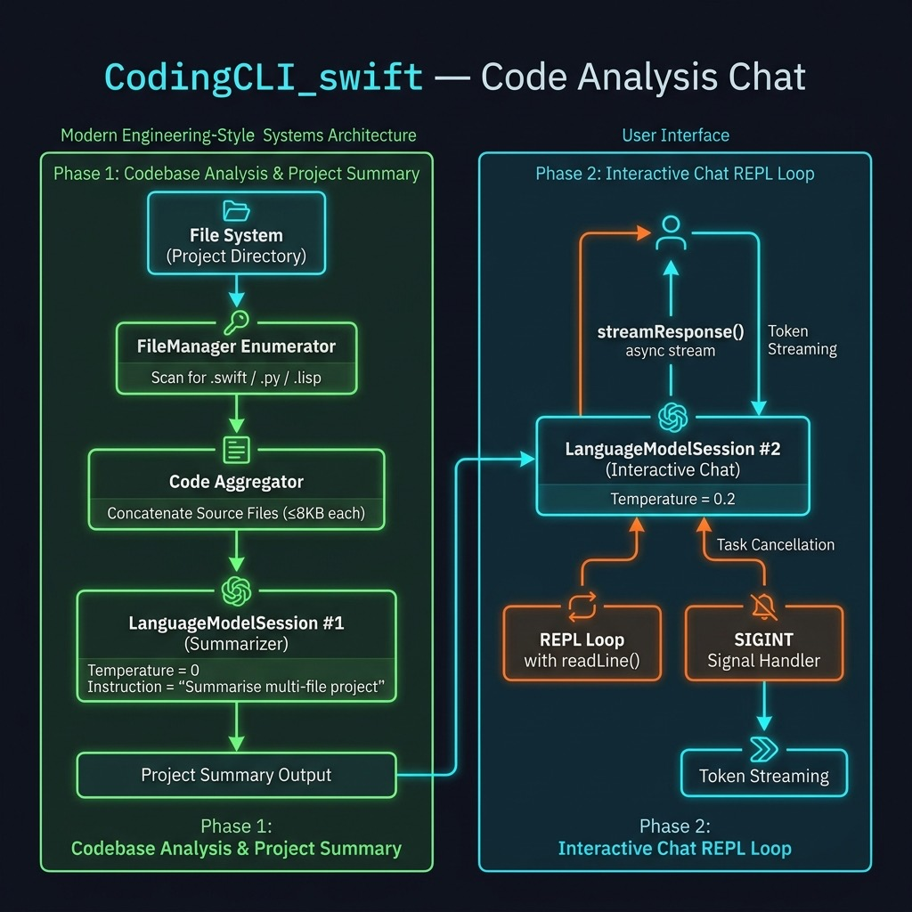

# CodingCLI — AI Coding Agent (Apple Intelligence, OpenAI-compatible, and local MLX models) — Example for Mark Watson's book "Artificial Intelligence Using Swift"

Book URI: https://leanpub.com/SwiftAI

You can read my book for free online at: https://leanpub.com/SwiftAI/read

An AI pair programmer in your terminal: a multi-turn agentic loop with six tools (`read_file`, `list_dir`, `grep`, `run_shell`, `propose_edit`, `fetch_url`), human-approved colored diffs, and a choice of LLM backends — the on-device **Apple Intelligence** model (FoundationModels, no API key), any **OpenAI-compatible** cloud endpoint (Fireworks.ai, DeepSeek, …), or a **local MLX/Ollama** server.

This is a Swift port of the feature set of the Racket `racket-coding-agent` project (itself a port of the Python `py-coding-agent`).

## Features

- **Agentic loop** with six tools: `read_file`, `list_dir`, `grep`, `run_shell` (whitelisted: `make`, `ls`, `pwd`, `cat`, `uv`), `propose_edit`, and `fetch_url` (reads a web page as plain text; prompts containing a URL are routed to the tool loop)
- **Colorized unified diffs** with `y/n/s` approval before any file is touched; `--dry-run` never writes, `-y` auto-approves (still showing the diff)
- **`make check` gate** — runs after every accepted edit and reports failures back to the model
- **Safety guards** — stale-base / no-op / empty-file checks on edits; hidden files (`.env`, `foo~`, `#foo#`) refused; repeated identical tool calls stop the loop
- **Intent classifier** (keyword heuristic + LLM fallback) routes general questions to web search and coding tasks to the tools
- **Web search** with Brave or Exa
- **MCP servers** — tools from any stdio [Model Context Protocol](https://modelcontextprotocol.io) server declared under `mcpServers` in the global or local config, including [iMCP](https://github.com/mattt/iMCP) for macOS Calendar, Contacts, Reminders, Messages, Location, Maps, and Weather
- **Skills** — `/<name>` loads `~/.agents/skills/<name>/SKILL.md` into the conversation
- **Context tools** — `/context` shows a per-message breakdown, `/compact` summarizes history to save tokens, `/summary` summarizes the source files in the current directory
- **Token accounting** — `/tokens` with cost estimates (including cached-input pricing) from the provider config
- **Unix-friendly one-shot mode** with script-friendly exit codes
- **Line editing** — history, `Ctrl-R`, and Tab completion via libedit, with persistent history

## Requirements

| Requirement | Minimum |
|---|---|
| macOS | 26 (Tahoe) |
| Xcode | 17+ (for the FoundationModels framework) |
| Apple Intelligence | Enabled in System Settings — only for the built-in `apple` provider |

Optional environment variables: `FIREWORKS_API_KEY`, `DEEPSEEK_API_KEY` (or whatever a provider's `api_key_env` names), and `BRAVE_SEARCH_API_KEY` / `EXA_SEARCH_API_KEY` for web search.

## Build & Install

    swift build              # or: make build
    make install             # release build copied to /usr/local/bin (PREFIX=... to change)

Shell completions for bash, zsh, and fish are in `completions/`.

## Usage

    CodingCLI                                  # interactive REPL in the current directory
    CodingCLI "fix the bug in calc.py"         # one-shot
    CodingCLI -p "refactor foo" -p "add tests" # repeatable prompt parts
    echo "explain Tools.swift" | CodingCLI --stdin
    CodingCLI --cwd ~/proj --provider apple "summarize this project"
    CodingCLI --provider mlx --model llama3.2:3b "hi"
    CodingCLI -y "apply the fix"               # auto-approve diffs (still shows them)
    CodingCLI --dry-run "show what would change"
    CodingCLI --quiet --plain -p "hello" > out.txt

```
-p, --prompt TEXT     prompt text, repeatable, joined with newlines
--stdin               read prompt from stdin (pipe/heredoc)
-y, --yes             auto-approve propose_edit after showing diff
--dry-run             show diffs but do not write files
--provider NAME       provider profile from the harness config (or apple)
--model ID            override the model for this provider
--cwd DIR             chdir before running
--debug               log raw requests/responses (same as /debug)
-q, --quiet           no banner, no [intent] line, less tool chatter
--plain, --no-color   no ANSI colors in diffs
-v, --version         show version and exit
-h, --help            show help and exit
```

Exit codes: `0` ok, `1` model/network error, `2` `make check` failed, `3` change rejected/skipped, `5` bad arguments.

Press `Ctrl-C` during a model turn to cancel that turn without leaving the REPL.

## Providers and the harness config

Two JSON config layers are merged at startup — project-local wins over global, nested objects merge recursively, and other values are replaced wholesale:

* **Global:** `~/.coding_harness.json`
* **Local:** `.local_coding_harness.json` in the project directory

See `coding_harness.example.json` for a full example:

```json
{
  "default_provider": "fireworks",
  "providers": {
    "fireworks": {
      "type": "openai",
      "endpoint": "https://api.fireworks.ai/inference/v1/chat/completions",
      "api_key_env": "FIREWORKS_API_KEY",
      "model": "accounts/fireworks/models/deepseek-v4p1-flash",
      "generation": { "temperature": 0.6, "max_tokens": 32768 },
      "pricing": { "input": 0.14, "cached_input": 0.028, "output": 0.28 }
    },
    "mlx": {
      "type": "mlx",
      "endpoint": "http://localhost:11434/v1/chat/completions",
      "model": "qwen3.8:27b-mlx",
      "generation": { "temperature": 0.6, "max_tokens": 32768 }
    }
  },
  "search": { "engine": "brave", "enabled": false },
  "mcpServers": {
    "iMCP": { "command": "/Applications/iMCP.app/Contents/MacOS/imcp-server" }
  },
  "quiet": false, "plain": false, "debug": false
}
```

Provider types:

| Type | Backend |
|---|---|
| `openai` | OpenAI-style chat completions with SSE streaming (Fireworks.ai, DeepSeek, compatible endpoints) |
| `mlx` | Non-streaming OpenAI-style `/v1/chat/completions` (`mlx_lm.server`, oMLX, Ollama); `ollama`, `omlx`, `sushi` are aliases; optional Bearer key via `api_key_env` |
| `apple` | On-device Apple Intelligence via FoundationModels — no key, no network |

* An `apple` profile is **built in**, so CodingCLI works with no config at all. It is the default only when the config declares no other providers. Its context window is small, so only the tail of earlier conversation is replayed to it.
* The default profile is `default_provider`, else `fireworks` if present, else the first profile alphabetically.
* Optional per-profile `pricing` (USD per 1M tokens: `input`, `cached_input`, `output`) gives `/tokens` its cost estimate; without it, `/tokens` reports counts only.
* Switch profiles with `/provider <name>`; `/provider` alone lists them.

Legacy settings (precedence CLI > env > legacy file > harness config):

* File: `$XDG_CONFIG_HOME/coding-agent/config.json` or `~/.config/coding-agent/config.json`, a flat object such as `{"provider": "mlx", "model": "m", "quiet": true, "plain": true, "debug": false, "search": true, "search-engine": "exa"}`. Its `provider` applies only when there is no harness config.
* Env: `CODING_AGENT_PROVIDER` / `AGENT_PROVIDER`, `CODING_AGENT_MODEL`, `CODING_AGENT_QUIET`, `CODING_AGENT_PLAIN`, `CODING_AGENT_DEBUG`.

## MCP servers

CodingCLI is an MCP client. Servers go under `mcpServers` in `~/.coding_harness.json` or `.local_coding_harness.json`, in the same format that Claude Desktop and Claude Code use. Only the stdio transport is supported.

```json
"mcpServers": {
  "iMCP":  { "command": "/Applications/iMCP.app/Contents/MacOS/imcp-server" },
  "files": { "command": "npx", "args": ["-y", "@modelcontextprotocol/server-filesystem", "."],
             "env": { "DEBUG": "0" }, "timeout": 60 }
}
```

| Key | Meaning |
|---|---|
| `command` | Executable (absolute path, or a name looked up on `PATH`) |
| `args` | Argument list (optional) |
| `env` | Extra environment variables (optional) |
| `timeout` | Seconds to wait for each request; default 30 (the `initialize` handshake waits at least 60) |
| `disabled` | `true` skips the server, so a project-local file can switch off a global server |

Each server starts once, when the REPL or a one-shot run begins. Its tools are registered as `mcp__<server>__<tool>`. A server that fails to start prints a warning and is skipped. `/mcp` lists the running servers and their tools, and `--debug` also logs the JSON-RPC traffic and server stderr.

MCP tools are offered on every route. On the coding and hybrid routes they sit next to the six built-in tools. On the general route, which normally does only web search, the model can call MCP tools as well, so questions such as "what's the weather" or "what's on my calendar today" are answered from your own data. The on-device `apple` provider has a small context window, so it gets MCP tools only on the general route. MCP tool calls are not gated by the diff approval prompt; control what a server can do in its own settings.

### iMCP (macOS)

[iMCP](https://github.com/mattt/iMCP) is a menu-bar app that serves your Calendar, Contacts, Location, Maps, Messages, Reminders, Weather, and more over MCP.

1. Install iMCP from its GitHub releases page, launch it, and turn on the services you want from its menu-bar icon. Grant the macOS permissions it asks for.
2. Add the entry shown above to `~/.coding_harness.json`. The server command is also shown in the iMCP menu.
3. Start CodingCLI. The first time it connects, iMCP shows an approval dialog. Click **Allow**, and optionally check "Always trust this client". CodingCLI waits up to 60 seconds for that approval.

```
> what's on my calendar tomorrow?
[intent: general → web search + MCP tools, no coding tools]
* mcp__iMCP__<calendar tool> {...}
```

## REPL commands

| Command | Description |
|---|---|
| `/reset` | Clear conversation history |
| `/history` | Dump the full message log |
| `/context` | Show a formatted summary of the current context |
| `/compact` | Compact history into a summary, then show the new context |
| `/summary` | Scan `.swift`/`.py`/`.lisp` files here and summarize the project |
| `/model <id>` | Switch model for the current provider |
| `/provider` | Show the current provider and available profiles |
| `/provider <name>` | Switch provider profile |
| `/debug` | Toggle raw request/response logging |
| `/search` | Toggle web search on/off |
| `/search brave` / `/search exa` | Enable web search with that engine |
| `/tokens` | Show session token usage and estimated cost |
| `/mcp` | List running MCP servers and their tools |
| `/skills` | List skills in `~/.agents/skills` |
| `/<skill-name>` | Load that skill into the conversation |
| `/quit` | Exit (an empty line at EOF also exits) |

## Line editing and history

On a terminal the REPL uses libedit (loaded at run time with `dlopen`): arrow keys, `Ctrl-A`/`Ctrl-E`/`Ctrl-K`/`Ctrl-U`/`Ctrl-W`, `Ctrl-R` reverse search, and `Tab` completion of slash commands, provider profiles, search engines, and configured model ids. History persists to `~/.coding_agent_history` (last 1000 entries; shared with the Racket version). Piped input falls back to plain line reading, as it does if libedit cannot be loaded.

## Project Structure

```
CodingCLI_swift/
├── Package.swift
├── Makefile                   # build / check / install (make check gates every accepted edit)
├── coding_harness.example.json
├── completions/               # bash, zsh, fish
└── Sources/CodingCLI/
    ├── CodingCLI.swift        # @main entry point, CLI flag parsing
    ├── Agent.swift            # REPL, slash commands, skills, context, intent routing, one-shot mode
    ├── ChatLoop.swift         # provider-agnostic agentic tool-calling loop
    ├── OpenAIClient.swift     # OpenAI-compatible SSE + MLX clients, token/cost stats
    ├── AppleProvider.swift    # Apple Intelligence provider, FoundationModels tools, /summary
    ├── Tools.swift            # tool registry and the six agent tools
    ├── Approval.swift         # settings, subprocess helper, colored diffs, y/n/s prompts
    ├── HarnessConfig.swift    # hierarchical JSON config, provider profiles, legacy config
    ├── Search.swift           # Brave and Exa web search
    ├── WebFetch.swift         # fetch_url: download a page, HTML -> plain text
    ├── MCP.swift              # MCP stdio client: servers from "mcpServers", tools as mcp__server__tool
    ├── LineInput.swift        # libedit line editing, history, Tab completion
    └── JSON.swift             # JSON value type
```



## Book Cover Material, Copyright, and License

This example is released using the Apache 2 license.

Copyright 2022-2026 Mark Watson. All rights reserved.

## This Book is Licensed with Creative Commons Attribution CC BY Version 3 That Allows Reuse In Derived Works

You are free to:

- Share — copy and redistribute the material in any medium or format
- Adapt — remix, transform, and build upon the material
for any purpose, even commercially.

You are required to give appropriate credit in any derived works:

```text
This work is derived from all or part of "Artificial Intelligence Using Swift" by
Mark Watson. Source: https://leanpub.com/SwiftAI
```

Please visit the [author's website](http://markwatson.com).
